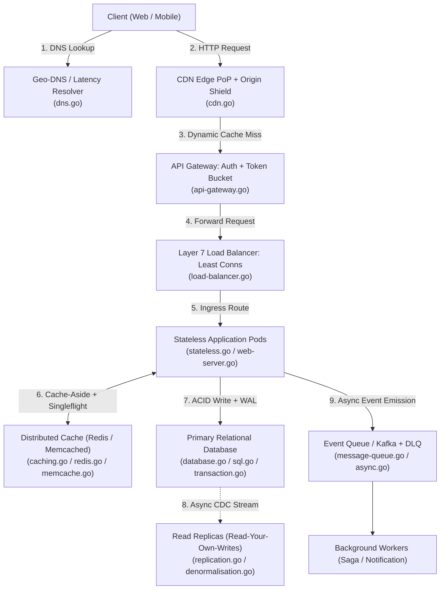

# System Design Interview Preparation (SD3 / Staff Level) in Go

A comprehensive, production-grade repository of fundamental and advanced distributed systems building blocks written in idiomatic **Go**. Designed specifically for **Senior / Staff Software Engineer (SD3)** system design interviews at companies such as Google, Meta, Amazon, Uber, Netflix, and Stripe.

Every example is a self-contained, runnable Go program featuring:
- Real algorithms and data structures (LRU, Bloom Filters, Consistent Hashing, LSM-Trees, Token Buckets, B+ Trees, Quorums).
- Deep architectural insights, trade-offs, and failure mode mitigations.
- Concurrency, thread safety (`sync.RWMutex`, atomic counters, channels, contexts).
- Visual console outputs and latency benchmarks.

---

## Architecture Blueprint (The Full Request Lifecycle)



---

## Table of Contents & Module Map

| Module File | Core Topic | Key SD3 Concept & Algorithm | Command to Run |
| :--- | :--- | :--- | :--- |
| [`system.go`](file:///Users/prakash/Documents/projects/homework/go/system-design-ai/system.go) | **End-to-End System** | Full request traversal: DNS → CDN → Gateway → LB → Cache → DB → Event Bus | `go run system.go` |
| [`caching.go`](file:///Users/prakash/Documents/projects/homework/go/system-design-ai/caching.go) | **LRU & Stampede** | O(1) Doubly-Linked List + Map, Singleflight request coalescing | `go run caching.go` |
| [`cache-invalidation.go`](file:///Users/prakash/Documents/projects/homework/go/system-design-ai/cache-invalidation.go) | **Invalidation Races** | Delayed Double Deletion, Delete vs Update, Versioned CAS tokens | `go run cache-invalidation.go` |
| [`ttl.go`](file:///Users/prakash/Documents/projects/homework/go/system-design-ai/ttl.go) | **TTL & Reaping** | Passive (lazy) vs Active Redis-style sampling reaper, TTL jitter | `go run ttl.go` |
| [`memcache.go`](file:///Users/prakash/Documents/projects/homework/go/system-design-ai/memcache.go) | **Memcached Internals** | Slab Allocator (pages & chunks), Client-side Ketama consistent hashing | `go run memcache.go` |
| [`redis.go`](file:///Users/prakash/Documents/projects/homework/go/system-design-ai/redis.go) | **Redis & Redlock** | Single-threaded event loop, Sorted Sets (ZSET), Safe Lua distributed locks | `go run redis.go` |
| [`dns.go`](file:///Users/prakash/Documents/projects/homework/go/system-design-ai/dns.go) | **DNS & Routing** | Recursive resolution, Geo-DNS latency routing, Weighted canary shifts | `go run dns.go` |
| [`cdn.go`](file:///Users/prakash/Documents/projects/homework/go/system-design-ai/cdn.go) | **Edge CDN** | Edge PoP, Origin Shield, conditional 304 Not Modified, `stale-while-revalidate` | `go run cdn.go` |
| [`load-balancer.go`](file:///Users/prakash/Documents/projects/homework/go/system-design-ai/load-balancer.go) | **Load Balancing** | L4 vs L7, Round Robin, Weighted RR, Least Connections, IP Hash | `go run load-balancer.go` |
| [`forward-proxy.go`](file:///Users/prakash/Documents/projects/homework/go/system-design-ai/forward-proxy.go) | **Forward Proxy** | Egress security, client IP masking, HTTP CONNECT TLS tunneling | `go run forward-proxy.go` |
| [`reverse-proxy.go`](file:///Users/prakash/Documents/projects/homework/go/system-design-ai/reverse-proxy.go) | **Reverse Proxy** | Path-based routing, header injection (`X-Forwarded-For`), 502 handling | `go run reverse-proxy.go` |
| [`proxy.go`](file:///Users/prakash/Documents/projects/homework/go/system-design-ai/proxy.go) | **Service Mesh Sidecar** | Envoy pattern, circuit breaking (Closed/Open/Half-Open), telemetry | `go run proxy.go` |
| [`api-gateway.go`](file:///Users/prakash/Documents/projects/homework/go/system-design-ai/api-gateway.go) | **API Gateway** | Token Bucket rate limiter, API key auth, BFF request aggregation | `go run api-gateway.go` |
| [`web-server.go`](file:///Users/prakash/Documents/projects/homework/go/system-design-ai/web-server.go) | **Production Server** | Graceful shutdown, Slowloris defense (`ReadHeaderTimeout`), panic recovery | `go run web-server.go` |
| [`http.go`](file:///Users/prakash/Documents/projects/homework/go/system-design-ai/http.go) | **HTTP Evolution** | HTTP/1.1 HoL blocking vs HTTP/2 binary multiplexing vs HTTP/3 QUIC | `go run http.go` |
| [`rest.go`](file:///Users/prakash/Documents/projects/homework/go/system-design-ai/rest.go) | **REST API Design** | Idempotency Keys for non-safe methods, Cursor vs Offset pagination | `go run rest.go` |
| [`rest-call.go`](file:///Users/prakash/Documents/projects/homework/go/system-design-ai/rest-call.go) | **Resilient Client** | `MaxIdleConnsPerHost` tuning, Exponential backoff with Full Jitter | `go run rest-call.go` |
| [`graphql.go`](file:///Users/prakash/Documents/projects/homework/go/system-design-ai/graphql.go) | **GraphQL & N+1** | AST field resolution, Facebook DataLoader (request batching & caching) | `go run graphql.go` |
| [`tls.go`](file:///Users/prakash/Documents/projects/homework/go/system-design-ai/tls.go) | **TLS 1.3 & mTLS** | 1-RTT ECDHE handshake, PKI trust chain validation, Mutual TLS (mTLS) | `go run tls.go` |
| [`auth.go`](file:///Users/prakash/Documents/projects/homework/go/system-design-ai/auth.go) | **Auth & RBAC** | Stateless JWT (HMAC-SHA256), tamper resistance, Refresh Token Rotation | `go run auth.go` |
| [`request.go`](file:///Users/prakash/Documents/projects/homework/go/system-design-ai/request.go) | **Distributed Tracing**| W3C TraceContext (`traceparent`), OpenTelemetry spans, Baggage | `go run request.go` |
| [`database.go`](file:///Users/prakash/Documents/projects/homework/go/system-design-ai/database.go) | **Storage Engine** | Write-Ahead Log (WAL), RAM Buffer Pool, ARIES crash recovery replay | `go run database.go` |
| [`indexing.go`](file:///Users/prakash/Documents/projects/homework/go/system-design-ai/indexing.go) | **DB Indexing** | B+ Trees vs LSM-Trees (MemTable + SSTables), Bloom Filters, Leftmost Prefix | `go run indexing.go` |
| [`sql.go`](file:///Users/prakash/Documents/projects/homework/go/system-design-ai/sql.go) | **SQL Execution** | Connection pool sizing (`MaxOpenConns`), In-memory Hash Join engine | `go run sql.go` |
| [`nosql.go`](file:///Users/prakash/Documents/projects/homework/go/system-design-ai/nosql.go) | **NoSQL & Quorums** | Cassandra/Dynamo tunable quorum math ($W + R > N$), PACELC theorem | `go run nosql.go` |
| [`transaction.go`](file:///Users/prakash/Documents/projects/homework/go/system-design-ai/transaction.go) | **Transactions** | Two-Phase Commit (2PC) blocking flaws vs Saga Compensating Transactions | `go run transaction.go` |
| [`isolation.go`](file:///Users/prakash/Documents/projects/homework/go/system-design-ai/isolation.go) | **Isolation & MVCC** | ANSI levels, MVCC snapshot isolation, Write Skew anomaly demonstration | `go run isolation.go` |
| [`sharding.go`](file:///Users/prakash/Documents/projects/homework/go/system-design-ai/sharding.go) | **Horizontal Sharding**| Direct shard routing vs Scatter-Gather cross-shard fanout | `go run sharding.go` |
| [`partitioning.go`](file:///Users/prakash/Documents/projects/homework/go/system-design-ai/partitioning.go) | **Consistent Hashing** | Hash ring with Virtual Nodes (VNodes), minimal $1/(N+1)$ key migration | `go run partitioning.go` |
| [`replication.go`](file:///Users/prakash/Documents/projects/homework/go/system-design-ai/replication.go) | **Replication Lag** | Sync vs Async replication, Read-Your-Own-Writes gateway routing | `go run replication.go` |
| [`data-modeling.go`](file:///Users/prakash/Documents/projects/homework/go/system-design-ai/data-modeling.go) | **Feed Data Model** | Twitter Hybrid Fan-out: Push for regular users, Pull for celebrities | `go run data-modeling.go` |
| [`normalisation.go`](file:///Users/prakash/Documents/projects/homework/go/system-design-ai/normalisation.go) | **Normalization** | 1NF, 2NF, 3NF decomposition, Update/Insert/Delete anomaly prevention | `go run normalisation.go` |
| [`denormalisation.go`](file:///Users/prakash/Documents/projects/homework/go/system-design-ai/denormalisation.go) | **CQRS Projections** | Pre-aggregated counters, Materialized views via Transactional Outbox CDC | `go run denormalisation.go` |
| [`message-queue.go`](file:///Users/prakash/Documents/projects/homework/go/system-design-ai/message-queue.go) | **Message Queues** | Competing consumers, backpressure, poison pill Dead Letter Queues (DLQ)| `go run message-queue.go` |
| [`async.go`](file:///Users/prakash/Documents/projects/homework/go/system-design-ai/async.go) | **Async Pipelines** | Fan-Out / Fan-In parallel compute with context deadline cancellation | `go run async.go` |
| [`synchronous.go`](file:///Users/prakash/Documents/projects/homework/go/system-design-ai/synchronous.go) | **Cascading Failures** | Synchronous thread exhaustion, Request Hedging (Dean & Barroso) | `go run synchronous.go` |
| [`stateless.go`](file:///Users/prakash/Documents/projects/homework/go/system-design-ai/stateless.go) | **Stateless Pods** | Externalized session storage, instant horizontal autoscaling | `go run stateless.go` |
| [`statefull.go`](file:///Users/prakash/Documents/projects/homework/go/system-design-ai/statefull.go) | **Stateful & Raft** | Raft consensus leader election, term leases, majority quorum voting | `go run statefull.go` |
| [`latency.go`](file:///Users/prakash/Documents/projects/homework/go/system-design-ai/latency.go) | **Tail Latency Math** | Percentiles (P50, P99, P99.9), Dean & Barroso amplification $1 - (1-p)^N$ | `go run latency.go` |
| [`actor.go`](file:///Users/prakash/Documents/projects/homework/go/system-design-ai/actor.go) | **Actor Supervision** | Erlang/OTP supervisor tree pattern in Go, panic recovery and restarts | `go run actor.go` |
| [`ackerman.go`](file:///Users/prakash/Documents/projects/homework/go/system-design-ai/ackerman.go) | **Deep Recursion** | Algorithmic computational complexity and call-stack limits | `go run ackerman.go` |

---

## Latency Numbers Every SD3 Candidate Must Know

| Operation | Latency (Human Time Scale @ 1 GHz = 1 sec) |
| :--- | :--- |
| **L1 CPU Cache Reference** | 0.5 ns (0.5 sec) |
| **Branch Mispredict** | 5 ns (5 sec) |
| **L2 CPU Cache Reference** | 7 ns (7 sec) |
| **Mutex Lock / Unlock** | 25 ns (25 sec) |
| **Main Memory (RAM) Reference** | 100 ns (1.7 min) |
| **Compress 1KB with Zstandard** | 2,000 ns (33 min) |
| **Read 1MB sequentially from Memory** | 3,000 ns (50 min) |
| **Read 1MB sequentially from NVMe SSD**| 50,000 ns (14 hours) |
| **SSD Random Read (Seek)** | 100,000 ns (1.1 days) |
| **Round Trip within same Datacenter** | 500,000 ns (5.7 days) |
| **HDD Random Seek (Spinning Disk)** | 10,000,000 ns (4 months) |
| **Read 1MB sequentially from HDD** | 20,000,000 ns (8 months) |
| **Send packet CA → Netherlands → CA** | 150,000,000 ns (4.7 years) |

---

## How to Execute the Examples

All programs are written to execute independently using the standard Go toolchain:

```bash
# Run any system design topic directly:
go run caching.go
go run redis.go
go run sharding.go
go run transaction.go
go run isolation.go
go run load-balancer.go
go run latency.go
go run system.go
```

Each script outputs detailed execution logs, architectural diagnostics, and senior interview takeaways directly to the console.
