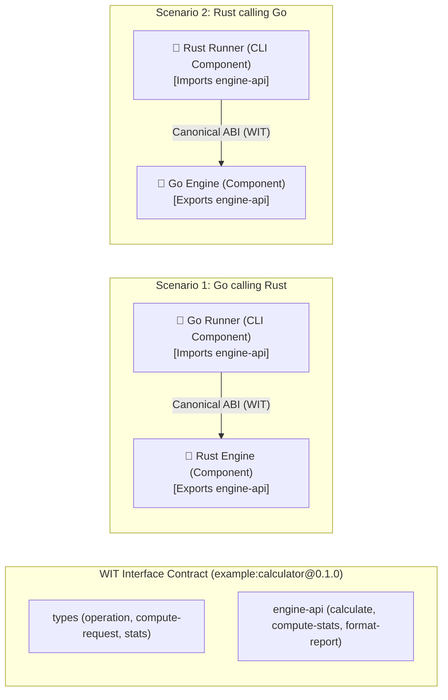

# WebAssembly Component Communication via WIT in Rust & Go

This project demonstrates **cross-language WebAssembly Component Model communication** using **WebAssembly Interface Types (WIT)** across **Rust** and **Go**.

It implements bidirectional composition:
1. **Scenario 1**: **Go CLI Component** (Consumer) importing and calling a **Rust Library Component** (Provider).
2. **Scenario 2**: **Rust CLI Component** (Consumer) importing and calling a **Go Library Component** (Provider).

---

## 🏗️ Architecture Overview



---

## 📜 WIT Interface Specification ([wit/calculator.wit](./wit/calculator.wit))

```wit
package example:calculator@0.1.0;

interface types {
    enum operation {
        add,
        subtract,
        multiply,
        divide,
    }

    record compute-request {
        op: operation,
        a: f64,
        b: f64,
    }

    record stats {
        count: u32,
        min: f64,
        max: f64,
        mean: f64,
        sum: f64,
    }
}

interface engine-api {
    use types.{operation, compute-request, stats};

    calculate: func(req: compute-request) -> result<f64, string>;
    compute-stats: func(numbers: list<f64>) -> result<stats, string>;
    format-report: func(title: string, data: stats) -> string;
}

world engine {
    export engine-api;
}

world runner {
    import engine-api;
}
```

---

## 📂 Project Structure

```
.
├── wit/
│   └── calculator.wit        # Shared WIT contract defining interfaces & worlds
├── rust-engine/              # Rust component exporting calculator::engine-api
│   ├── Cargo.toml
│   └── src/
│       ├── bindings.rs       # Generated WIT bindings
│       └── lib.rs            # Rust Guest implementation
├── go-runner/                # Go component importing calculator::engine-api
│   ├── go.mod
│   ├── main.go               # Go CLI orchestration calling engine
│   └── realloc.go            # Canonical ABI allocator (cabi_realloc)
├── go-engine/                # Go component exporting calculator::engine-api
│   ├── go.mod
│   ├── main.go               # Go calculation engine implementation
│   └── realloc.go            # Canonical ABI allocator
├── rust-runner/              # Rust component importing calculator::engine-api
│   ├── Cargo.toml
│   └── src/
│       └── main.rs           # Rust CLI orchestration calling engine
├── adapters/                 # WASI Preview 1 adapter binaries
├── build.sh                  # Automated build & composition script
├── run.sh                    # Execution script
├── Makefile                  # make build / make run
└── README.md
```

---

## ⚙️ Prerequisites

1. **Rust**: `rustc` & `cargo` with `wasm32-wasip2` and `wasm32-wasip1` targets:
   ```bash
   rustup target add wasm32-wasip2 wasm32-wasip1
   ```
2. **Go & TinyGo**:
   - `go` >= 1.22
   - `tinygo` >= 0.33
3. **WebAssembly Tools**:
   - `wasmtime` (Wasm runtime): `brew install wasmtime`
   - `wasm-tools`: `brew install wasm-tools`
   - `wit-bindgen-go`: `go install go.bytecodealliance.org/cmd/wit-bindgen-go@latest`
   - `wac-cli`: `cargo install wac-cli`

---

## 🚀 How to Build & Run

### 1. Build and Run All Scenarios
```bash
make all
```

Or step-by-step:
```bash
# Build all components and compose them
make build

# Run both scenarios in wasmtime
make run
```

---

## 🔍 Step-by-Step Breakdown

### 1. Rust Engine (Provider)
- Generates Rust bindings using `wit_bindgen::generate!({ path: "../wit", world: "engine" })`.
- Implements `Guest` trait for `exports::example::calculator::engine_api::Guest`.
- Compiles directly to a WASM component targeting `wasm32-wasip2`:
  ```bash
  cargo build --manifest-path rust-engine/Cargo.toml --target wasm32-wasip2 --release
  ```

### 2. Go Runner (Consumer)
- Generates Go bindings using `wit-bindgen-go generate --world runner ../wit/calculator.wit`.
- Calls exported methods `engineapi.Calculate(...)`, `engineapi.ComputeStats(...)`, and `engineapi.FormatReport(...)`.
- Compiles with TinyGo (`-target=wasip1 -scheduler=none`) and componentizes using `wasm-tools component new` with the WASI command adapter:
  ```bash
  tinygo build -target=wasip1 -scheduler=none -o go_runner.core.wasm .
  wasm-tools component embed ../wit/calculator.wit --world runner go_runner.core.wasm -o go_runner.embed.wasm
  wasm-tools component new go_runner.embed.wasm --adapt wasi_snapshot_preview1=adapters/wasi_snapshot_preview1.command.wasm -o dist/go-runner.wasm
  ```

### 3. Go Engine (Provider)
- Generates Go bindings using `wit-bindgen-go generate --world engine ../wit/calculator.wit`.
- Registers exports `engineapi.Exports.Calculate`, `engineapi.Exports.ComputeStats`, etc.
- Compiles with TinyGo (`-buildmode=c-shared`) and componentizes with the WASI reactor adapter.

### 4. Rust Runner (Consumer)
- Generates Rust bindings using `wit_bindgen::generate!({ path: "../wit", world: "runner" })`.
- Calls `bindings::example::calculator::engine_api::calculate(...)`.
- Compiles targeting `wasm32-wasip2`.

### 5. Component Composition (`wac plug`)
Using `wac` (WebAssembly Composable):
```bash
# Plug Rust Engine into Go Runner
wac plug --plug dist/rust-engine.wasm dist/go-runner.wasm -o dist/composed-go-calling-rust.wasm

# Plug Go Engine into Rust Runner
wac plug --plug dist/go-engine.wasm dist/rust-runner.wasm -o dist/composed-rust-calling-go.wasm
```

---

## 📊 Sample Execution Output

```
================================================================
🎯 Scenario 1: Go Runner (Consumer) calling Rust Engine (Provider)
================================================================
🚀 [Go Runner] Initializing WASM Component...
   Addition (128.5 + 71.5) -> Result: 200.00
   Multiplication (12.5 * 8.0) -> Result: 100.00
   Division (100.0 / 4.0) -> Result: 25.00
   Division by zero (42.0 / 0.0) -> Handled Error: Division by zero in Rust Engine

=== [Rust Engine] Telemetry Sample Analysis ===
• Samples: 7
• Minimum: 12.40
• Maximum: 89.00
• Sum:     339.80
• Average: 48.54

✅ [Go Runner] Completed communication with Engine successfully!

================================================================
🎯 Scenario 2: Rust Runner (Consumer) calling Go Engine (Provider)
================================================================
🦀 [Rust Runner] Initializing WASM Component...
   Addition (500.25 + 250.75) -> Result: 751.00
   Multiplication (16.0 * 4.5) -> Result: 72.00
   Subtraction (1000.0 - 333.33) -> Result: 666.67
   Division (99.0 / 3.0) -> Result: 33.00
   Division by zero (10.0 / 0.0) -> Handled Error: Division by zero in Go Engine

=== [Go Engine] Sensor Array Readings ===
• Count:   6
• Minimum: 50.25
• Maximum: 420.00
• Sum:     1201.50
• Mean:    200.25

✅ [Rust Runner] Completed communication with Engine successfully!
```
